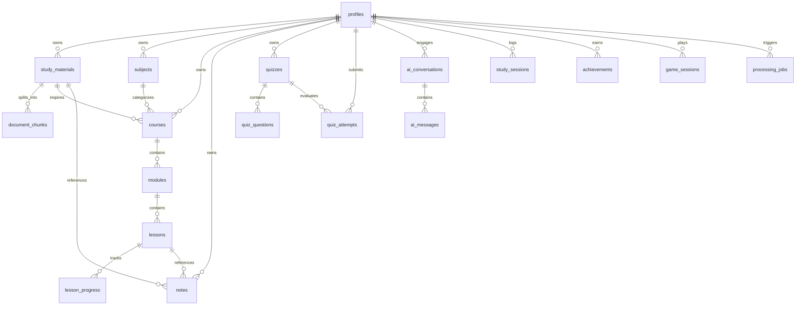

# 🌲 Wildwood Academy
## Full-Stack AI-Powered Learning Management System

Wildwood Academy is a production-grade, full-stack Learning Management System designed around an enchanted woodland aesthetic. It empowers scholars to transform their personal study materials (PDFs, DOCX files, Markdown notes, and scanned handwritten pages) into structured courses, source-grounded AI tutoring dialogues, personalized revision notes, server-graded trial quizzes, and a living botanical growth journey.

---

## 🍃 Core Learning Architecture & Capabilities

1. **The Woodland Library (`/groves`)**
   - Drag-and-drop file ingestion supporting PDF, DOCX, TXT, Markdown, and PNG/JPEG/WebP images.
   - Real server-side document parsing and Optical Character Recognition (OCR via Tesseract.js).
   - Text chunking (~1200 characters with 200-character overlap) preserving section titles, headings, and page indices.
   - Private storage architecture with verified user authorization and safe file downloads.

2. **Course & Lesson Synthesis (`/learning`)**
   - AI-driven curriculum synthesis generating structured modules and ordered lessons from study scrolls.
   - Comprehensive lesson views with learning objectives, rich teaching text, key terms glossaries, worked examples, recaps, and interactive knowledge checks.
   - Lesson progress tracking with measured focused study duration and Lore XP rewards.

3. **The Forest Guide AI Tutor (`/tutor`)**
   - Source-grounded conversational AI tutor using Retrieval-Augmented Generation (RAG).
   - Retrieves matching document chunks isolated strictly to the authenticated student's private library.
   - Attributes exact quotations and page citations to uploaded source materials.
   - Adapts teaching style (Socratic, structured, concise, visual) and tone according to student preferences.

4. **Scribe's Corner (`/scribe`)**
   - AI-generated notes in five distinct formats: **Detailed Explanatory**, **Concise Revision Bullets**, **Beginner-Friendly Analogies**, **Exam Cram Sheets**, and **Q&A Flashcards**.
   - Preserves student manual revisions and personal annotations when notes are updated.
   - Full search and filtering across notes.

5. **The Trial Grounds (`/trials`)**
   - Rigorous multiple-choice, true/false, and short-answer quizzes.
   - **Server-Side Grading Engine**: Correct answers and grading criteria are never exposed to the client prior to submission.
   - Explanations and comprehensive feedback returned upon submission, tracking historical attempts.

6. **Growth Journal & Gamification (`/journal`)**
   - Real-time progress metrics calculated from persistent database records (not mock numbers).
   - **Virtual Plant Growth Visualizer**: Interactive botanical plant that evolves through 5 distinct growth stages (*Enchanted Seed* → *Sprouting Seedling* → *Bioluminescent Fern* → *Moonlit Blossom* → *Ancient Heartwood Tree*) fueled by genuine Lore XP.
   - Woodland achievement badges unlocked through authentic study milestones.
   - Automated identification of weak topics for targeted revision.

7. **Firefly Quest Mini-Game (`/clearing`)**
   - Playable educational game guiding a woodland creature along a moonlit trail.
   - Dynamically loads questions directly from the student's courses or study materials.
   - **Anti-Cheat Validation**: Server validates answer accuracy, streak multipliers, and fireflies collected to prevent forged scores or fraudulent XP.

8. **Pixie Trail Cursor Effect**
   - Elegant gold (`#F2BE64`) and sage (`#A7B99A`) sparkling particle trail following desktop pointer movement.
   - Completely non-blocking (`pointer-events: none`).
   - Automatically disabled on touch devices and respects `prefers-reduced-motion`.

---

## 🏰 Design System & Visual Palette

- **Forest Green** (`#173F30`, `#0D241B`): Primary mystical background and surface depth.
- **Moss Green** (`#527B57`): Secondary accents, progress bars, and healthy states.
- **Sage** (`#A7B99A`): Subdued typography, borders, and supporting details.
- **Parchment** (`#F5EBD5`, `#FDF8ED`): Warm readable text and note surfaces.
- **Lantern Amber** (`#F2BE64`): Glowing highlights, milestones, buttons, and rewards.
- **Dark Ink** (`#26372C`): High-contrast typography on light cards.

Typography combines storybook serif headings (`Cinzel`) with accessible, high-legibility sans-serif body text (`Inter`).

---

## 🏛️ Entity Relationship Diagram (ERD)



---

## 🛠️ Technology Stack

| Layer | Technology |
|---|---|
| **Frontend** | Next.js 14 (App Router), React 18, TypeScript, Tailwind CSS, Lucide Icons |
| **Backend & APIs** | Next.js Route Handlers with server-side authorization and schema validation |
| **Primary Database** | Supabase PostgreSQL with Row Level Security (RLS) & Migrations |
| **Local Persistence** | Atomic file-backed JSON database engine (`data/wildwood.json`) for zero-friction local development |
| **Private File Storage** | Supabase Storage (`study_materials` bucket) with local file-system fallback (`storage/uploads/`) |
| **Document Processing** | `pdf-parse`, `mammoth` (DOCX), `tesseract.js` (Optical Character Recognition) |
| **AI Intelligence** | Google Gemini API (`gemini-1.5-flash`), OpenAI (`gpt-4o-mini`), and domain synthesis fallback |
| **Cryptography** | Salted `scrypt` password hashing + HMAC-SHA256 authenticated session tokens |

---

## 🚀 Getting Started

### 1. Prerequisites
- **Node.js**: v18.0.0 or higher (v20+ recommended).
- **npm** or **pnpm**.

### 2. Installation
```bash
# Clone or navigate to the repository
cd d:\LMS

# Install dependencies
npm install
```

### 3. Environment Configuration
Copy `.env.example` to `.env.local`:
```bash
cp .env.example .env.local
```

Configure your credentials in `.env.local`:
```env
# Wildwood Academy Environment Configuration

# 1. Supabase Backend (Optional for cloud Postgres & Storage)
NEXT_PUBLIC_SUPABASE_URL=https://your-project.supabase.co
NEXT_PUBLIC_SUPABASE_ANON_KEY=your-anon-public-key
SUPABASE_SERVICE_ROLE_KEY=your-supabase-service-role-key

# 2. AI Intelligence Providers (Configure at least one for live LLM calls)
GEMINI_API_KEY=your-gemini-api-key
# or OPENAI_API_KEY=your-openai-api-key

# 3. Application Security & Session Secret
APP_SESSION_SECRET=wildwood-enchanted-secret-salt-key-replace-in-production
NEXT_PUBLIC_APP_URL=http://localhost:3000
```

> **Note on Zero-Configuration Local Mode**: If Supabase credentials or AI keys are not provided, Wildwood Academy runs in **Local Atomic Mode** (`data/wildwood.json`) and **Domain Synthesis Mode**. All features (file uploads, chunking, courses, notes, quizzes, grading, progress, and mini-game) work out of the box with 100% persistent data!

---

## 📜 Supabase Database Migrations & Setup

To deploy the schema to your Supabase PostgreSQL project:
1. Open your Supabase Dashboard → **SQL Editor**.
2. Open the migration file: [`supabase/migrations/20261101000000_wildwood_academy_schema.sql`](file:///d:/LMS/supabase/migrations/20261101000000_wildwood_academy_schema.sql).
3. Execute the SQL script. This will create:
   - All 18 relational tables with constraints and foreign keys.
   - Vector extension (`vector`) for similarity search.
   - Row Level Security (RLS) enabled on every single table.
   - Granular RLS policies isolating records strictly by `auth.uid() = user_id`.
   - Private storage bucket `study_materials` with user folder isolation policies.

---

## 🧪 Automated Testing Suite

Wildwood Academy includes an automated integration and security test suite covering:
- Cryptographic password hashing & session token signing.
- Document parsing and sliding-window chunking.
- **Cross-user isolation security acceptance test** (User B cannot read User A's files, chunks, courses, notes, or RAG searches).
- Course generation and lesson progress calculations.
- User edit preservation in Scribe's Corner notes.
- Server-side quiz grading (verifying zero answer leakage to clients).
- Gamification, Lore XP calculation, and virtual plant growth stages.
- Firefly Quest anti-cheat verification and score validation.

To run the automated suite:
```bash
npm test
```

Expected output:
```
======================================================
TEST RESULTS: 43 PASSED | 0 FAILED
======================================================
```

---

## 🏃 Running the Application

### Development Mode
```bash
npm run dev
```
Open [http://localhost:3000](http://localhost:3000) in your browser.

### Production Build & Launch
```bash
npm run build
npm run start
```

---

## 🛡️ Security & Privacy Guarantees

1. **Strict Cross-User Isolation**: Every database query, storage access, chunk search, and progress calculation checks ownership against the authenticated session user.
2. **Private File Storage**: Uploaded PDFs and images are never exposed via public URLs. Authenticated streaming endpoints verify ownership before delivering bytes.
3. **Hidden Quiz Answers**: Quizzes delivered to clients contain prompts and options only; correct answers and grading rubrics remain securely on the server until submission.
4. **Anti-Cheat Gamification**: Scores, Lore XP, and game session rewards cannot be forged by client requests; rewards are calculated and clamped strictly on the server.
5. **Account Deletion Protocol**: Scholars can delete their accounts at any time from Settings, purging all associated documents, chunks, notes, and records.

---

*Authored with care for Wildwood Academy · Where lore flourishes under the forest canopy.*
